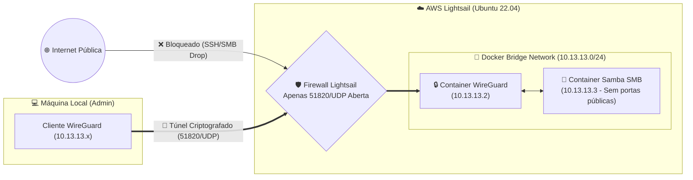

# 🔐 Private Cloud Infrastructure (Zero-Trust VPN + File Server)


Infraestrutura em nuvem automatizada e isolada, projetada sob os princípios de **Zero-Trust** e **Hardening de Rede**. O ambiente provisiona um servidor privado de arquivos (**Samba/SMB**) na AWS, totalmente invisível para a internet pública e acessível exclusivamente através de um túnel criptografado **WireGuard VPN**.

---

## 🏗️ Arquitetura da Solução

Todo o tráfego externo é bloqueado no firewall da borda da AWS, permitindo apenas pacotes UDP autenticados por chaves criptográficas na porta da VPN.



---

## 🚀 Diferenciais Técnicos e Boas Práticas

* **Superfície de Ataque Mínima (Hardening):** Após o provisionamento inicial, a porta SSH (`22/TCP`) é removida do firewall público. A administração remota e o acesso aos arquivos ocorrem estritamente pela rede interna da VPN.
* **Isolamento de Containers:** O serviço Samba não possui mapeamento de portas (`ports`) no host. Ele comunica-se exclusivamente através de uma rede Docker Bridge dedicada (`10.13.13.0/24`).
* **Provisionamento Automatizado (IaC / Scripting):** Criação da instância, instalação de dependências, geração dinâmica de senhas fortes (`OpenSSL`) e regras de firewall executadas via **AWS CLI** e **User-Data**.
* **Gestão de Custos (FinOps):** Scripts dedicados para subir e destruir a infraestrutura sob demanda, evitando gastos ociosos na nuvem.

---

## 📂 Estrutura do Repositório

```text
private-cloud-infra/
├── docker-compose.yml       # Orquestração dos containers WireGuard e Samba
├── .env.example             # Template de variáveis de ambiente
├── .gitignore               # Proteção contra vazamento de chaves e credenciais
├── scripts/
│   ├── deploy.sh            # Provisiona a instância na AWS e sobe os serviços
│   ├── lockdown.sh          # Remove o SSH público e aplica o hardening final
│   └── destroy.sh           # Destrói os recursos na AWS para zerar custos
└── docs/                    # Evidências de testes, prints e diagramas
```

---

## ⚙️ Como Executar

### Pré-requisitos
* Conta na AWS com **AWS CLI** configurada (`aws configure`)
* Cliente **WireGuard** instalado na máquina local

### Passo a Passo
1. **Provisionar a infraestrutura na nuvem:**
   ```bash
   ./scripts/deploy.sh
   ```
2. **Coletar a chave de acesso da VPN:**
   Acesse o servidor temporariamente via SSH, copie o arquivo `config/wireguard/peer1/peer1.conf` para `/etc/wireguard/wg0.conf` na sua máquina local e ative o túnel:
   ```bash
   sudo wg-quick up wg0
   ```
3. **Aplicar o Hardening (Trancar o servidor):**
   Com o túnel VPN ativo, remova o acesso SSH público da internet:
   ```bash
   ./scripts/lockdown.sh
   ```
4. **Acessar o Servidor de Arquivos Privado:**
   Conecte-se via gerenciador de arquivos ou terminal usando o IP interno do container Samba:
   ```text
   smb://10.13.13.3/ArquivosPrivados
   ```
5. **Encerrar o ambiente (FinOps):**
   ```bash
   ./scripts/destroy.sh
   ```

---

## 👤 Autor

**Érico Murta**  
* [GitHub](https://github.com)
